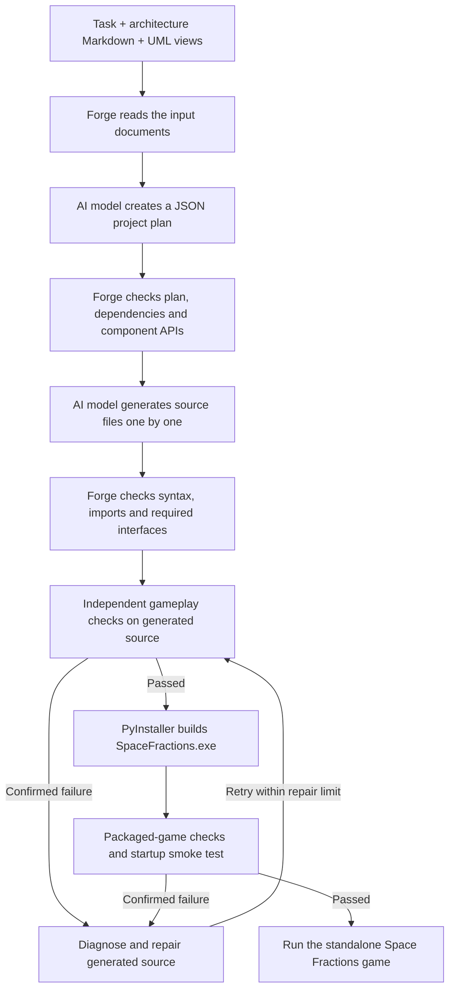

# Forge — Desktop Coding Agent

Forge reads architecture Markdown and UML views, uses DeepSeek to generate a
Space Fractions desktop game, checks basic gameplay, and builds a standalone
Windows executable. It supports official DeepSeek and OpenRouter API keys.

## How Forge works (coding agent workflow)

Forge is a **multi-step coding agent**, not a single prompt that returns a finished
code block. It reads the supplied software design, asks an AI model to plan the
project, creates source files one at a time, checks the result, and builds a
playable Windows game. The desktop app is the interface for this process; the
actual generation is handled by `GenerationJob` in [`main.py`](main.py).

### Workflow diagram



### Step-by-step process

1. **Read the requirements.** The user opens `Forge.exe`, selects an API provider
   and model, enters a game-generation task, attaches the two files in [`input/`](input/)
   (`Architecture_Documentation.md` and `Architecture_View.md`), and chooses an output
   folder. `read_selected_files()` in `main.py` loads the UTF-8 text and combines it
   into labeled input sections. The supplied architecture includes UML views and
   server-oriented ideas that Forge adapts into a Python desktop game.

2. **Create the project plan.** `GenerationJob.run()` sends the task and combined
   architecture to the chosen DeepSeek/OpenRouter-compatible model. Its first
   response is a **JSON manifest** describing requirements, architecture choices,
   source-file paths, each file's purpose, public interfaces, and dependencies.
   Forge validates this plan and applies the canonical desktop contracts from
   [`game_blueprint.py`](game_blueprint.py) (or
   [`legacy_blueprint.py`](legacy_blueprint.py) for an older run). An invalid plan
   can be sent back for correction.

3. **Generate the code file by file.** Forge follows the manifest in dependency
   order. For each file, the agent sends a focused request containing the project
   plan and the already-written dependency files, then saves the model's response
   as an actual file in the new project directory. Python outputs are syntax-checked
   before saving; a syntax error can trigger a correction request. The generated
   game includes its domain logic, fraction question content, controller, score
   storage, tests, and documentation. The graphical `forge_ui.py` foundation is
   **provided by Forge**, not generated by the model.

4. **Check the source and component contracts.** Forge inspects imports and source
   structure and checks that the generated modules match the expected interfaces.
   Its local compatibility adapters can normalize specific API/data-format
   mismatches. These adapters do not provide prewritten fraction questions or
   scoring rules. See `GenerationJob.validate_source()` and
   `normalize_generation_api()` in `main.py`.

5. **Validate gameplay.** The independent
   [`acceptance_gate.py`](acceptance_gate.py) verifies essential behavior such as
   valid fraction answers, scoring, question progression and the desktop UI. Forge
   runs these checks against the generated source and, after packaging, the frozen
   executable. A startup smoke test also checks that the EXE launches without
   Python on `PATH`. Model-generated tests are run separately as **advisory** checks;
   their warnings are reported rather than treated as confirmed gameplay failures.

6. **Repair confirmed failures when needed.** If a required gameplay check or the
   Windows build fails, [`repair_engine.py`](repair_engine.py) and
   [`repair_protocol.py`](repair_protocol.py) help diagnose the observed failure and
   request focused code changes. Forge retries the build/check process, with **at
   most two model repair rounds** for confirmed delivery failures. If the problem
   remains, Forge reports it instead of claiming the game was successfully built.
   A successful run may need **zero** repairs.

7. **Package and launch the game.** On Windows, `build_desktop()` in `main.py` uses
   PyInstaller to create a one-file, windowed `SpaceFractions.exe` inside the
   generated project folder. After the required checks pass, the user can click
   **Play game** in Forge or launch the EXE directly. The packaged game does not
   need Forge, an API key, or an installed Python interpreter to play.

### What Forge produces and how to inspect it

Each new run creates a `SpaceFractions_...` folder inside the selected output
location. In a successful local build, reviewers can inspect these artifacts:

| Artifact | What it shows |
| --- | --- |
| Generated `.py` files and `tests/` | Real game logic, UI controller, questions, persistence and tests produced for the run. |
| Generated `README.md` and `COMPONENT_APIS.md` | Game instructions and the model's documented component interfaces. |
| `.agent/last-plan.txt` | Raw project plan returned by the model. |
| `.agent/run.json` | Validated manifest, completed-file hashes, API request usage, and resumable checkpoint state. |
| `.agent/product-acceptance.json` | Essential gameplay check results for the generated source. |
| `.agent/packaged-acceptance.json` | Essential gameplay check results for the packaged application. |
| `.agent/desktop-build.json` and `.agent/build.log` | Packaging status, validation summary, warnings and build details. |
| `SpaceFractions.exe` | Standalone playable Windows game generated and packaged by Forge. |

Some reports appear only after the corresponding stage has run. The desktop UI
also shows the generation plan, progress messages, and estimated token/cost usage.
The per-run API budget guard is **$0.95**; estimates may differ from the provider's
final bill. `GenerationJob.checkpoint()` preserves completed work, and **Resume run**
can continue an interrupted generation using the same task and input files.

**Important distinction:** Forge itself supplies the desktop agent, validation,
build tools, and reusable visual components. The AI model supplies the generated
game's logic and content within those contracts. This is why reviewers should
watch both the **agent generating files** and the resulting **game running**.

## Run the Windows package

Download **Forge.zip** from this repository's Releases page. This is the runnable
package; GitHub's automatically generated source-code ZIP contains development
source instead.

1. Extract the complete Forge folder and run **Forge.exe**. Keep runtime beside it.
2. Select the provider and enter your own API key. Remember key is optional and
   uses encryption tied to the current Windows account.
3. Attach both Markdown files from the packaged inputs folder and select a writable
   output directory.
4. Generate the game. After basic checks and packaging, **Play game** becomes available.
5. Run **SpaceFractions.exe** directly inside the generated project folder, or use
   Play game. The generated EXE runs offline independently of Forge.

No Python installation is needed to use the complete Windows x64 package or the
generated game. Forge bundles its local build runtime; the game embeds its runtime.
Generation needs internet and API credit. A clean Windows VM was unavailable;
runtime independence was checked on the development PC with Windows-only PATH.

## Demonstration

Demonstration video: https://youtu.be/qcEGNtRQ5mk

## Design and attribution

The supplied web/microservices architecture is adapted into one desktop process.
The model generates domain logic, fraction questions and answers, storage, the
controller, tests and documentation. Forge supplies an attributed graphical
component library: space scenery, operand diagrams, progress graphics and controls.
Local API adapters enforce declared data types and documented member names; they
do not supply a question bank or scoring algorithm. Original Markdown inputs are
preserved under input/.

The game uses basic fractions and whole-number answers with exact Fraction equality.
Basic launch, visible questions, scoring, progression, results, replay and saving
are checked in source and the EXE. Help/editor checks and model-written tests are
advisory; their warnings remain logged and do not cause paid repair loops. Confirmed
gameplay/build failures receive at most two repair rounds within the existing budget.
The default maximum per-run guard is $0.95; displayed estimates are not provider bills.

## Source layout

- main.py: desktop agent, providers, generation/checkpoints and local packaging.
- game_blueprint.py and legacy_blueprint.py: versioned generation contracts.
- foundation/: reusable graphical components.
- acceptance_gate.py and validation_runner.py: gameplay and advisory test reporting.
- repair_engine.py and repair_protocol.py: observed-failure repairs and history.
- keyvault.py: optional Windows account-encrypted key storage.
- tests/: offline agent regressions and recorded response fixtures.
- input/: original architecture Markdown and UML views.
- scripts/: offline tests and portable release assembly.

## Development

Use Python 3.12 on Windows for source development:

```powershell
python -m pip install -r requirements.txt
python scripts/verify_offline_repairs.py
python main.py
python main.py --package-agent
```

Portable assembly additionally needs a complete provisioned Python 3.12 runtime
with Tkinter, PyInstaller and pytest. Use scripts/assemble_release.py with that
runtime and a new output directory. The published Forge.zip already contains it.
The repository excludes binaries, runtime files, generated games and API keys.

## Recorded validation

The final Basic Play update passed 123 guarded offline agent tests with no network
or saved-key access. One fresh official generation completed in 11 requests with
zero model repairs, at approximately US$0.148 configured estimated cost. Its basic
source/frozen gameplay and optional control-based editor checks passed. One generated
editor test remained an advisory warning. Manual EXE play confirmed visible questions,
operand diagrams, correct feedback, scoring and Next. These results do not guarantee
every later model response or constitute clean-OS testing.

See docs/known-limitations.md for execution and environment limitations.

## Optional browser backup

The working Windows desktop package is the primary submission. Task 1 permits a
CLI-launched browser alternative for intractable desktop-build obstacles, with a
partial engineering-point deduction. A separate portable backup is available as
Forge-Web-Backup-v2-Windows-x64.zip. See [fallback instructions](fallback/README.md)
and [offline verification](docs/fallback-verification.md). From development source,
run `python fallback/web_agent.py`; the portable backup includes its own runtime.
Fallback verification made no provider requests; mocked downloads are explicitly
labeled as test fixtures. The expanded guarded agent suite passed 131 tests.

### Fallback version 2

Choose path browses local folders inside the web page. Build saved project rebuilds
existing generated source locally without a key or model requests. The score reader
now unwraps the JSON envelope its writer produces; raw-list compatibility remains.
The failed real run passed source/frozen gameplay and score persistence after the
local correction and produced its EXE, with its usage ledger unchanged. The guarded
agent suite passed 136 tests. Restart an old running backend to load the update.
